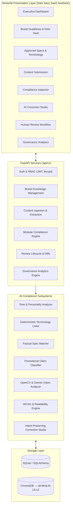

# BrandShield AI — Intelligent Brand Governance & Compliance Platform

> **CodeZen India 2026 Round 2: The Build**  
> **Tagline:** *Every piece of content. One trusted brand identity.*  
> **Category:** AI-powered Brand Governance and Content Compliance Platform  
> **Author:** Sole Developer Project Submission  

[](https://www.python.org/)
[](https://fastapi.tiangolo.com/)
[](https://streamlit.io/)
[](https://www.trychroma.com/)
[]()

---

## 1. Executive Summary

Modern enterprises distribute content creation across internal marketing teams, external agencies, freelance creators, and generative AI writing assistants. This decentralization causes:
- **Brand voice inconsistency** (fragmented tones and irregular messaging styles)
- **Factual contradictions** (inaccurate specs, outdated pricing, conflicting warranties)
- **Unsubstantiated promotional claims** ("world's number one", "guaranteed success", unauthorized superlatives)
- **Visual identity & accessibility violations** (off-brand colors, poor contrast ratios, missing alt-text)
- **Governance failures** (lack of centralized approval, untracked revisions, zero accountability)

**BrandShield AI** is an enterprise-grade brand governance platform that acts as an intelligent quality-control checkpoint before publication. It reviews submitted content against approved brand guidelines, verified facts, terminology, and visual assets—explaining why inconsistencies matter, providing supporting evidence, and suggesting intent-preserving corrections without removing human decision-making authority.

---

## 2. The Three Key Product Improvements

### 🔹 Improvement 1: Evidence-First Brand Intelligence
BrandShield AI moves beyond generic LLM critique. Every detected violation links directly to an approved brand guideline, specification, or regulatory policy.
- Exact problematic snippet highlighted
- Citation to approved ground truth fact (e.g. *"NovaBook Pro Battery: 12 hours (Source: Official Hardware Spec Sheet 2026, Section 3.2)"*)
- Objective risk-based severity classification (`CRITICAL`, `HIGH`, `MEDIUM`, `LOW`)
- Transparent, weighted compliance scoring:
  $$\text{Compliance Score} = \max\left(0, 100 - (25 \times \text{Critical} + 15 \times \text{High} + 5 \times \text{Medium} + 2 \times \text{Low})\right)$$

### 🔹 Improvement 2: Multimodal Brand Compliance
Content compliance is not limited to plain text:
- **Text & Document Analysis:** Evaluates PDF, DOCX, TXT, and Markdown files.
- **Deterministic Color Palette Inspection:** Uses OpenCV K-Means clustering to extract dominant colors and measures delta distance to approved brand palettes (`#0B132B`, `#1C2541`, `#5BC0BE`).
- **WCAG 2.1 AA Accessibility:** Calculates relative luminance and contrast ratios (checking against the 4.5:1 requirement).
- **Contextual Visual AI:** Leverages Gemini Vision for contextual image layout, distortion, and suitability inspection.

### 🔹 Improvement 3: Human-Controlled Governance Intelligence
Automated algorithms advise, but human reviewers govern:
- Complete status lifecycle: `Draft` &rarr; `Submitted for review` &rarr; `Under review` &rarr; `Changes requested` &rarr; `Resubmitted` &rarr; `Approved` &rarr; `Rejected`
- Non-destructive side-by-side diff studio (Original vs AI Suggested vs User Edit)
- Immutable revision history and review comment threads with user attribution
- Governance analytics identifying recurring organizational errors and suggesting brand guideline refinements.

---

## 3. System Architecture



---

## 4. NovaTech Canonical Demonstration Scenario

BrandShield AI is pre-configured with a realistic enterprise organization (**NovaTech Global**):
- **Product:** NovaBook Pro
- **Approved Specifications:** Battery life: 12 hours | Warranty: 1 year | Base price: $1,299 USD
- **Brand Tone:** Professional, approachable and trustworthy
- **Approved Phrasing:** *"AI-powered productivity"*
- **Prohibited Phrases:** *"Guaranteed success"*, *"world's number one"*, *"100% guaranteed"*

### Submitted Flawed Advertisement:
> *"Introducing NovaBook Pro! The world's number one laptop with 24 hours of battery life and a 5-year warranty. Guaranteed success for every user!"*

### Detections & Evidence:
1. **Factual Contradiction (CRITICAL):** Claimed 24 hours battery life conflicts with approved 12 hours (*Source: NovaBook Pro Hardware Spec Sheet 2026, Section 3.2*).
2. **Factual Contradiction (CRITICAL):** Claimed 5-year warranty conflicts with approved 1-year warranty (*Source: Global Warranty Policy 2026*).
3. **Prohibited Terminology (HIGH):** *"Guaranteed success"* is strictly forbidden by risk governance.
4. **Unsupported Superlative Claim (HIGH):** *"world's number one"* requires certified independent market research citations under advertising law.
5. **Tone Hyperbole (MEDIUM):** Excessive exclamation marks conflict with calm, corporate authority.

### Generated Compliant Suggested Copy:
> *"Introducing NovaBook Pro, an AI-powered productivity laptop offering up to 12 hours of battery life and backed by a 1-year warranty."*

---

## 5. Quickstart & Installation

### Option A: Local Installation (Recommended)
```bash
# 1. Clone repository
git clone https://github.com/your-username/brandshield-ai.git
cd brandshield-ai

# 2. Create Python 3.12 virtual environment
python -m venv .venv
source .venv/bin/activate  # On Windows: .venv\Scripts\activate

# 3. Install dependencies
pip install -r requirements.txt

# 4. Launch both servers with one command
python run_servers.py
```
- **Streamlit Frontend:** [http://localhost:8501](http://localhost:8501)
- **FastAPI Backend:** [http://127.0.0.1:8000](http://127.0.0.1:8000)
- **Swagger Documentation:** [http://127.0.0.1:8000/docs](http://127.0.0.1:8000/docs)

### Option B: Docker Deployment
```bash
docker-compose up --build
```

---

## 6. Pre-Seeded Demonstration Accounts

| Role | Email | Password | Permissions |
| :--- | :--- | :--- | :--- |
| **Administrator** | `admin@novatech.com` | `Password123!` | Manage brand guidelines, edit facts, upload docs, full analytics |
| **Content Creator** | `creator@novatech.com` | `Password123!` | Ingest content, view findings, apply diffs, save revisions |
| **Brand Reviewer** | `reviewer@novatech.com` | `Password123!` | Audit submissions, comment, approve, reject, request changes |

*(Note: The UI includes a quick Role Persona Switcher in the sidebar for effortless judge evaluation.)*

---

## 7. Automated Test Suite

Run the full pytest suite:
```bash
pytest -v tests/
```

**Results (29/29 Passed):**
```text
tests/test_auth.py::test_login_success PASSED
tests/test_auth.py::test_login_invalid_password PASSED
tests/test_auth.py::test_user_registration PASSED
tests/test_auth.py::test_me_endpoint_with_auth PASSED
tests/test_compliance.py::test_novatech_demonstration_scenario PASSED
tests/test_content_upload.py::test_valid_document_upload_txt PASSED
tests/test_content_upload.py::test_valid_document_upload_md PASSED
tests/test_content_upload.py::test_valid_image_upload_png PASSED
tests/test_content_upload.py::test_unsupported_file_type_rejected PASSED
tests/test_content_upload.py::test_empty_file_upload_rejected PASSED
tests/test_content_upload.py::test_empty_submission_rejected PASSED
tests/test_content_upload.py::test_path_traversal_filename_sanitized PASSED
tests/test_content_upload.py::test_oversized_file_rejected_if_exceeds_configured_limit PASSED
tests/test_facts.py::test_pricing_verification_without_warranty_fact PASSED
tests/test_facts.py::test_pricing_verification_with_matching_warranty_fact PASSED
tests/test_facts.py::test_warranty_verification_missing_approved_facts PASSED
tests/test_facts.py::test_normal_successful_fact_verification PASSED
tests/test_facts.py::test_factual_violations_battery_and_warranty PASSED
tests/test_image_audit.py::test_compliant_image_colors PASSED
tests/test_image_audit.py::test_unapproved_image_flags_violations PASSED
tests/test_resilience_and_branding.py::test_health_endpoints PASSED
tests/test_resilience_and_branding.py::test_api_client_health_check_online PASSED
tests/test_resilience_and_branding.py::test_api_client_health_check_offline PASSED
tests/test_resilience_and_branding.py::test_submission_restoration_and_authorization PASSED
tests/test_resilience_and_branding.py::test_branding_has_no_stale_competition_references PASSED
tests/test_vision_accessibility.py::test_readability_metrics PASSED
tests/test_vision_accessibility.py::test_wcag_contrast_ratio PASSED
tests/test_vision_accessibility.py::test_color_distance PASSED
tests/test_workflow.py::test_full_workflow_lifecycle PASSED
======================= 29 passed, 4 warnings in 8.18s =======================
```

---

## 8. Changes from Original Proposal

1. **Self-Contained Local SQLite & ChromaDB Deployment:**  
   Instead of requiring complex external database clusters (PostgreSQL + Milvus/Pinecone) for Round 2 evaluation, the system utilizes an embedded SQLite relational database with SQLAlchemy and a local persistent ChromaDB vector store (`all-MiniLM-L6-v2`). This enables instant zero-friction setup and 100% offline verification while maintaining identical schema boundaries.
2. **Deterministic Rule-Based Retrieval Fallback:**  
   To guarantee platform reliability without external network or API key dependencies, a deterministic rule-based verification fallback was engineered alongside Gemini 1.5 Flash. If cloud API credentials are absent, the engine executes regex entity extraction, OpenCV color distance calculation, and WCAG luminance math offline with zero crashes.
3. **URL Query-Parameter Session Restoration:**  
   To ensure seamless evaluator review during browser refreshes, active submission state is synchronized to URL query parameters (`?sub_id=...`). The system validates tenant authorization against the active session token upon reload, preventing cross-tenant leakage while surviving page refreshes.
4. **Direct Tab Navigation Instead of a Separate Stepper:**  
   Rather than constraining evaluators to an artificial linear wizard stepper, the UI utilizes enterprise-standard navigation tabs with an instant Role Persona Switcher. This allows evaluators and reviewers to independently inspect any stage of the content governance lifecycle.

---

## 9. Known Limitations

1. **Static Multimodal Inspection Scope:** Current visual compliance analyzes static formats (PNG, JPG, WEBP). Video streams, animated media, and interactive HTML assets are not evaluated in Round 2.
2. **Single-Node Embedded Relational Storage:** The database operates on SQLite, optimal for prototype demonstration and local review. Enterprise multi-region clustering with PostgreSQL is planned for Round 3 production scale.
3. **Cloud API Key Dependency for Contextual Layout:** Contextual semantic image inspection relies on Google Gemini 1.5 Flash. While deterministic CV (palette distance, WCAG contrast) runs locally, rich contextual visual advice requires a valid `GEMINI_API_KEY`.

---

## 10. Three Proposed Round 3 Improvements

*(Note: These are proposed architectural enhancements for future development, not completed Round 2 features).*

### 🔹 Improvement 1: CI/CD & Automated Compliance Quality Gates
Integrate BrandShield AI directly into enterprise developer and marketer workflows via pre-commit Git hooks, GitHub Actions, and headless CMS webhooks (Contentful, Strapi, Sanity). Content commits and staging drafts will be automatically intercepted and evaluated, generating pull request review comments and blocking publication of unapproved assets.

### 🔹 Improvement 2: Jurisdiction-Specific Regulatory Rulebooks
Expand the modular compliance engine with dynamic regional rulebooks covering FTC endorsement guides (USA), ASCI advertising codes (India), and EU AI Act transparency disclosures. The engine will evaluate multi-jurisdiction marketing campaigns against local legal requirements dynamically based on target release regions.

### 🔹 Improvement 3: Active Learning & Guideline Auto-Tuning
Introduce an active learning feedback loop that analyzes human reviewer override patterns, approval edits, and dispute resolutions over time. The system will automatically suggest guideline clarifications to brand leadership when creators repeatedly trigger false positives or when reviewers consistently apply custom overrides.
