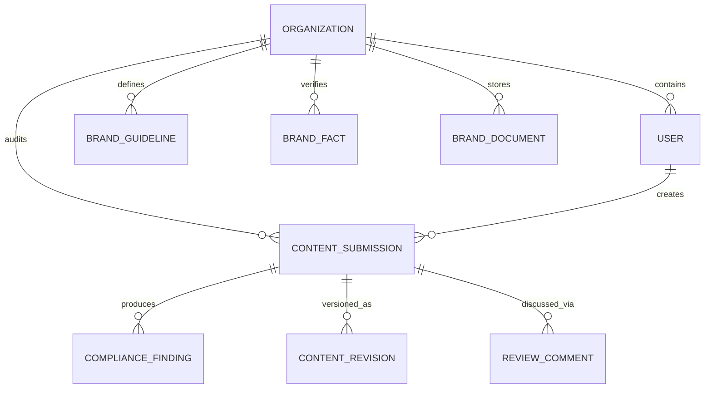
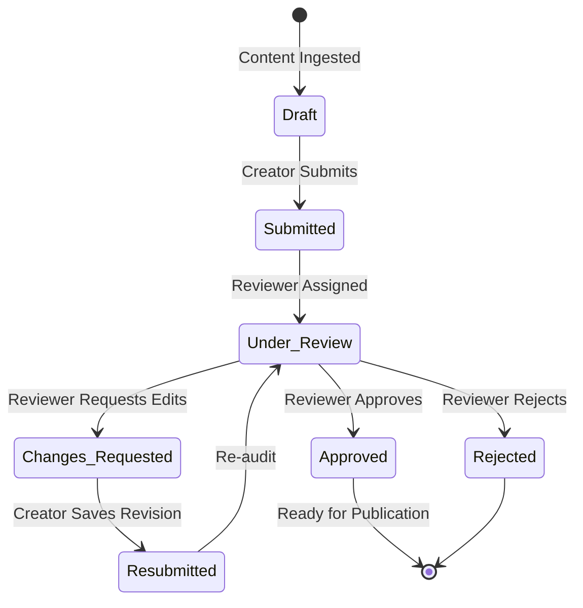

# BrandShield AI — Technical Architecture & System Design

## 1. Architectural Philosophy
BrandShield AI is built as a high-reliability, modular enterprise platform. It prioritizes:
- **Evidence-First Verification:** Avoiding subjective black-box LLM hallucinations by coupling semantic search with deterministic relational ground truth.
- **Explainability:** Delivering human-readable findings that cite exact sentences, approved specifications, and regulatory guidelines.
- **Human Authority:** Maintaining the principle that AI assists and scores, but designated human reviewers hold publication veto and approval authority.
- **Tenant Isolation:** Enforcing organization boundaries at the database and vector store layer.

---

## 2. Multi-Tenant Relational Data Model

All operational entities inherit organization-level scoping:

- **`Organization`:** Tenant root entity (`id`, `name`, `slug`).
- **`User`:** Identity & RBAC (`email`, `hashed_password` [bcrypt], `role` in `admin`, `creator`, `reviewer`).
- **`BrandGuideline`:** Visual and voice configuration (`prohibited_phrases`, `preferred_terminology`, `color_palette`, `typography_rules`, `approved_claims`).
- **`BrandFact`:** Verified relational specifications (`product_name`, `category`, `fact_key`, `fact_value`, `source_reference`).
- **`ContentSubmission`:** The audit target (`title`, `content_type`, `original_text`, `current_status`, `compliance_score`).
- **`ComplianceFinding`:** Structured compliance issues (`severity`, `category`, `problematic_snippet`, `explanation`, `approved_source_fact`).
- **`ContentRevision`:** Immutable revision ledger (`revision_number`, `content`, `version_label`, `changes_summary`).
- **`ReviewComment`:** Collaborative governance ledger (`user_id`, `comment`, `status_transition`).

---

## 3. Brand Knowledge Engine & Hybrid RAG

To prevent LLM hallucination and ensure 100% precision on numbers, dates, and prices, BrandShield AI employs a **Hybrid Ground Truth Engine**:

1. **Deterministic Relational Fact Store (SQLite):**
   - Stores exact verified hardware specs (battery life: `12 hours`, warranty: `1 year`, base price: `$1,299 USD`).
   - Exact regex matchers extract numbers and units from submitted copy and compare against authorized fact values.
2. **Semantic Vector Store (ChromaDB + Sentence Transformers):**
   - Ingests PDF, DOCX, TXT, and Markdown files.
   - Text is split into 500-character chunks with 50-character overlap.
   - Embeddings are generated using `sentence-transformers/all-MiniLM-L6-v2` (384-dimensional dense vectors).
   - Partitioned into tenant-isolated collections (`org_{org_id}_knowledge_vault`).

---

## 4. Modular Compliance Analysis Subsystems

Instead of a single brittle monolithic prompt, the audit pipeline is partitioned into specialized analyzers:

| Subsystem | Methodology | Output & Classification |
| :--- | :--- | :--- |
| **Terminology Analyzer** | Deterministic regex word-boundary evaluation | Identifies prohibited phrases (`HIGH`), non-preferred vocabulary (`MEDIUM`), capitalization errors (`LOW`). |
| **Factual Spec Matcher** | Entity-unit extraction & relational comparison | Flags spec contradictions (battery hours, warranty period, prices) as `CRITICAL` brand risk. |
| **Promotional Claim Analyzer** | Superlative & guarantee pattern recognition | Classifies claims into *Supported*, *Unsupported*, *Contradictory*, and *Requires Human Verification*. |
| **Tone & Voice Analyzer** | Stylistic and punctuation analysis | Detects multiple exclamation points (`!`), aggressive sales jargon, or casual slang in enterprise copy. |
| **Messaging Alignment** | Pillar keyword detection | Validates presence of mandatory brand positioning (e.g. *"AI-powered productivity"*). |
| **Multimodal Vision Engine** | OpenCV K-Means + WCAG relative luminance | Extracts top 5 dominant colors, computes Delta-E to brand palette, and tests 4.5:1 contrast ratio. |
| **Cognitive Accessibility** | Flesch-Kincaid & WCAG 2.1 heuristics | Computes Reading Ease score, detects sentences > 35 words, and flags missing image alt-text. |

---

## 5. Scoring Methodology

The overall compliance score is calculated via a deterministic, transparent formula:

$$\text{Compliance Score} = \max\left(0, 100 - (C \times 25 + H \times 15 + M \times 5 + L \times 2)\right)$$

Where:
- $C$ = Critical violations (direct factual contradictions, deceptive guarantees)
- $H$ = High violations (unsubstantiated superiority claims, prohibited terms, off-brand dominant colors)
- $M$ = Medium violations (tone inconsistencies, non-preferred terms, contrast failures, missing alt-text)
- $L$ = Low violations (capitalization, run-on sentences)

---

## 6. Human Review Lifecycle State Machine

